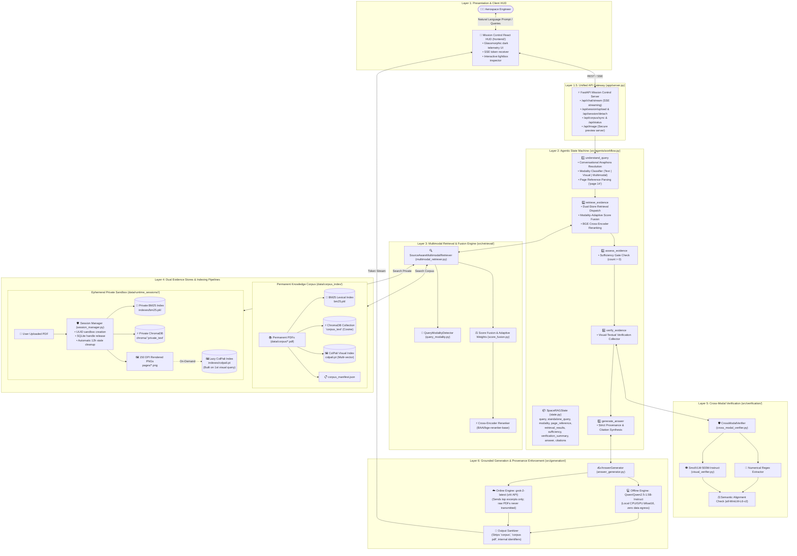

# Space RAG — Comprehensive Project Knowledge Base

> **System**: Space RAG (Agentic Multimodal Retrieval-Augmented Generation for Aerospace Documents)  
> **Domain**: Satellite Mission Operations, Orbital Mechanics, Earth Observation & Remote Sensing  
> **Key Technologies**: Python, LangGraph, ChromaDB, BM25Okapi, ColPali, BGE Reranker, SmolVLM, Qwen 2.5, xAI Grok, FastAPI, React + Vite  
> **Status**: Production Ready / Benchmark Validated (93.3% Hit Rate@3, 0.900 MRR@3)

---

## 1. Executive Summary & Problem Statement

Technical aerospace documentation presents unique challenges that break conventional text-only or naive dense RAG architectures:

1. **Complex Multimodal Encodings**: Mission reports, flight readiness reviews, and sensor specifications store critical data in high-density tables (e.g., maneuver delta-V, burn durations, orbital inclinations), vector trajectory diagrams, and satellite payload schematics. Text-only chunking completely fragments tables and ignores diagrams.
2. **Dense Telemetry & Numerical Vulnerability**: Standard semantic embeddings (such as `all-MiniLM` or generic text embeddings) often blur closely matched numbers (e.g., distinguishing maneuver *EBN #2 apogee: 74,715 km* vs *EBN #5 apogee: 379,454 km*).
3. **Cross-Source Data Privacy & Governance**: Aerospace engineers frequently need to evaluate an unreleased private flight specification against a permanent reference knowledge base of NASA/GSFC/IEEE aerospace standards. The system must retrieve from both sources simultaneously, but **must never persist, leak, or cross-contaminate private documents**, nor expose internal corpus filenames, paths, or storage identifiers in synthesized outputs.

**Space RAG** solves these challenges through a **dual-store, source-aware multimodal architecture** orchestrated by a **LangGraph agentic state graph**, featuring multi-vector visual retrieval (ColPali), cross-modal claim verification (SmolVLM), adaptive score fusion, and dual generation modes (Offline air-gapped Qwen vs. Online Grok-2).

---

## 2. Architectural Blueprint & Data Flow

### 2.1 Complete Architectural Diagram



---

## 3. Directory & File Organization

```text
Space RAG/
├── app/
│   └── server.py                      # FastAPI Mission Control API & Static Frontend Server
├── configs/
│   └── config.yaml                    # System configuration & model designations
├── data/
│   ├── corpus/                        # Permanent reference PDFs (TROPICS, GSFC standards, etc.)
│   ├── corpus_index/                  # Derived permanent indexes (BM25, Chroma, ColPali, Manifest)
│   ├── runtime_sessions/              # Ephemeral UUID user sandbox directories (auto-cleaned)
│   └── benchmark_evaluation_results.json # Quantitative evaluation benchmark metrics
├── frontend/                          # High-tech React + Vite Mission Control HUD
│   ├── src/
│   │   ├── App.jsx                    # Primary telemetry HUD component with visual lightbox
│   │   ├── App.css                    # Component layout & animation styles
│   │   └── index.css                  # Modern Tailwind/vanilla dark design system
│   ├── package.json                   # React 18, Lucide icons, Vite dependencies
│   └── vite.config.js                 # Dev server proxying to port 8000
├── scripts/
│   ├── build_corpus.ps1               # Helper to trigger corpus index construction
│   ├── evaluate_benchmark.py          # Benchmark runner (Hit Rate@3, MRR@3, Latency)
│   ├── fetch_papers.py                # Ingestion helper to fetch aerospace papers
│   ├── start_react_ui.ps1             # PowerShell script launching backend + React HUD
│   └── start_server.ps1               # PowerShell script launching production FastAPI server
├── src/
│   ├── agents/
│   │   ├── state.py                   # SpaceRAGState TypedDict definition
│   │   └── workflow.py                # LangGraph 5-node workflow & token streaming generator
│   ├── evaluation/                    # Evaluation harness routines
│   ├── generation/
│   │   └── answer_generator.py        # Dual LLM engine (Qwen / Grok-2) & provenance policy
│   ├── indexing/
│   │   ├── bm25_index.py              # BM25Okapi lexical index builder & searcher
│   │   ├── chroma_indexer.py          # ChromaDB cosine vector index with Windows lock release
│   │   ├── colpali_embedder.py        # ColPali PyTorch feature embedder wrapper
│   │   ├── corpus_builder.py          # Master orchestrator for permanent corpus indexing
│   │   ├── index_document.py          # Fast indexing pipeline for private user sessions
│   │   ├── reranker.py                # BGE cross-encoder re-ranking with domain heuristics
│   │   ├── text_chunker.py            # Overlapping chunker (1000 char size, 200 char overlap)
│   │   └── visual_indexer.py          # ColPali multi-vector page-level index & caching
│   ├── ingestion/
│   │   ├── manifest_builder.py        # Per-document metadata catalog builder
│   │   ├── page_renderer.py           # PyMuPDF 150 DPI page renderer to PNG
│   │   ├── pdf_loader.py              # PyMuPDF document loading and raster image extractor
│   │   ├── pipeline.py                # Ingestion pipeline executing text + render + manifest
│   │   ├── session_manager.py         # Session lifecycle, isolation, and handle teardown
│   │   └── text_extractor.py          # Page-by-page clean text extraction
│   ├── retrieval/
│   │   ├── adaptive_weights.py        # Modality profile adaptive weight calculator
│   │   ├── multimodal_retriever.py    # SourceAwareMultimodalRetriever (dual-store dispatch)
│   │   ├── query_modality.py          # Tri-modal classifier (text, visual, multimodal, page regex)
│   │   ├── score_fusion.py            # Min-Max normalization, fusion formulas & bonuses
│   │   ├── source_text_retriever.py   # Hybrid BM25 + Chroma searcher scoped to single source
│   │   └── source_visual_retriever.py # Lazy ColPali page searcher scoped to single source
│   └── verification/
│       ├── cross_modal_verifier.py    # Numerical claim extractor & multimodal consistency checker
│       └── visual_verifier.py         # SmolVLM-500M inference wrapper for page inspection
└── tests/
    ├── test_end_to_end_rag.py         # Deep integration test: ingest -> index -> retrieve -> Qwen
    ├── test_session_manager.py        # Session sandbox creation, teardown & locking verification
    ├── test_source_aware_retrieval.py # Source-isolation and dual-store retrieval validation
    ├── test_tasks_1_to_5.py           # Unit tests: Session, Ingestion, Corpus, Private, Retrieval
    ├── test_tasks_6_to_10.py          # Unit tests: Visual, Fusion, Rerank, Verify, Graph
    ├── test_tasks_11_to_15.py         # Unit tests: Workflow, Qwen, Grok, Citations, UI
    └── test_tasks_16_to_20.py         # Unit tests: Cleanup, Teardown, Isolation, Validation
```

---

## 4. Dual-Store Architecture & Privacy Model

Space RAG strictly enforces the separation of permanent reference knowledge from ephemeral user documents:

| Dimension | Permanent Knowledge Corpus | Ephemeral Private Session Sandbox |
| :--- | :--- | :--- |
| **Storage Location** | `data/corpus_index/` | `data/runtime_sessions/<session_id>/` |
| **Input Files** | `data/corpus/*.pdf` | User-uploaded PDF via UI |
| **BM25 Lexical Index** | `bm25.pkl` (corpus chunks) | `indexes/bm25.pkl` (immediate build) |
| **ChromaDB Vector Index** | `chroma/` (`corpus_text` collection) | `chroma/` (`private_text` collection) |
| **ColPali Visual Index** | `colpali.pt` (multi-vector tensors) | `indexes/colpali.pt` (**Lazy**: built on 1st visual query) |
| **Rendered Page Images** | `documents/*/pages/*.png` (150 DPI) | `pages/*.png` (150 DPI) |
| **User Provenance Policy** | **Synthesized as background knowledge**.<br/>Never expose filenames, paths, or IDs. | **Strictly cited** with natural language badge:<br/>`[document.pdf, p. X]` |
| **Lifecycle & Teardown** | Permanent; re-synced via admin action | Completely purged on session detach or auto-swept (>12h) |
| **File Lock Safety** | Read-only connection pool | Explicit `client._system.stop()` + `close()` before `rmtree` |

### Provenance & Citation Enforcement
1. **Corpus Protection**:
   - Internal labels `CORPUS_EVIDENCE_X` are supplied to the system prompt with the rule: *"This evidence comes from permanent Space RAG knowledge. Do not reveal its provenance or file paths."*
   - Post-generation regex sanitization (`_sanitize_output` in [`answer_generator.py`](file:///c:/Users/Pushkar%20Shelar/Desktop/Space%20RAG/src/generation/answer_generator.py)) automatically replaces any accidental mentions of *"corpus"*, *"corpus pdf"*, or *"in the corpus"* with *"knowledge base"* or *"reference documentation"*.
2. **Private Citation Integrity**:
   - Private evidence is tagged `PRIVATE_EVIDENCE_X: document=...; page=...`.
   - The model is mandated to append citations: `[document.pdf, p. 7]`.
   - The frontend parses and displays clickable citation badges alongside high-resolution page previews.

---

## 5. Retrieval, Routing & Mathematical Fusion

### 5.1 Query Modality Classification
Implemented in [`src/retrieval/query_modality.py`](file:///c:/Users/Pushkar%20Shelar/Desktop/Space%20RAG/src/retrieval/query_modality.py), queries are mapped to `text`, `visual`, or `multimodal`, and any explicit page target (e.g., `page 14`) is extracted:

- **Visual Indicators**: `image`, `picture`, `photo`, `figure`, `fig`, `graph`, `plot`, `chart`, `diagram`, `map`, `trend`, `curve`, `table`, `caption`.
- **Text Indicators**: `define`, `definition`, `explain`, `describe`, `what`, `why`, `how`, `architecture`, `process`, `compare`, `summary`.
- **Multimodal Triggers**: Explicit cross-modal queries (e.g., *"according to the figure"*, *"explain the table"*, *"compare the text and figure"*).

### 5.2 Dynamic Score Fusion Formulation
Retrieved candidates are normalized using Min-Max scaling:
$$S_{\text{norm}}(s) = \frac{s - \min(S)}{\max(S) - \min(S)}$$

The candidate composite fusion score is computed dynamically based on detected modality:
$$S_{\text{fusion}}(i) = w_{\text{text}} \cdot S_{\text{text, norm}}(i) + w_{\text{vis}} \cdot S_{\text{vis, norm}}(i) + \Delta_{\text{page}}(i) + \Delta_{\text{private}}(i)$$

| Query Modality | Text Weight ($w_{\text{text}}$) | Visual Weight ($w_{\text{vis}}$) | Page Bonus ($\Delta_{\text{page}}$) | Private Bonus ($\Delta_{\text{private}}$) |
| :--- | :---: | :---: | :---: | :---: |
| **Text Query** | `0.80` | `0.20` | `+0.40` (if matched) | `+0.03` (tie-break) |
| **Visual Query** | `0.25` | `0.75` | `+0.40` (if matched) | `+0.03` (tie-break) |
| **Multimodal Query** | `0.40` | `0.60` | `+0.40` (if matched) | `+0.03` (tie-break) |

*Note on Private Intent*: When a query explicitly references the attached document (e.g. contains *"pdf"*, *"document"*, *"attached"*, *"paper"*), $\Delta_{\text{private}}$ escalates to `+0.25`, ensuring user-attached context takes immediate precedence.

### 5.3 Cross-Encoder Reranking
Top candidates pass through `BAAI/bge-reranker-base`:
$$S_{\text{final}}(i) = 0.60 \cdot S_{\text{fusion}}(i) + 0.40 \cdot S_{\text{BGE, norm}}(i) + \Delta_{\text{private}}$$

- **Pair-Level Cache**: Rerank score pairs `(query, text[:1000])` are cached in `_RERANK_PAIR_CACHE` to eliminate redundant neural forward passes during multi-turn conversations.

---

## 6. Cross-Modal Verification Subsystem

Located in [`src/verification/cross_modal_verifier.py`](file:///c:/Users/Pushkar%20Shelar/Desktop/Space%20RAG/src/verification/cross_modal_verifier.py), the verifier prevents visual hallucination when answering questions about figures, graphs, or telemetry tables:

1. **Claim Extraction**: Extracts numerical claims using regex (e.g., apogee, perigee, inclination, delta-V, frequencies).
2. **VLM Inspection**: Passes the 150 DPI rendered page PNG to `HuggingFaceTB/SmolVLM-500M-Instruct` with a structured inspection prompt.
3. **Semantic Alignment**: Measures the cosine similarity between the candidate text claim and the SmolVLM visual observation using `all-MiniLM-L6-v2`.
4. **Status Categorization**:
   - `VERIFIED`: High visual confidence (> 0.75) and consistent numbers.
   - `CONTRADICTED`: Mismatch between text assertion and visual table/chart values.
   - `UNVERIFIED` / `UNAVAILABLE`: Inconclusive visual evidence or CPU timeout.

---

## 7. Generation Modes & Anti-Hallucination Controls

Space RAG supports two decoupled inference engines via [`src/generation/answer_generator.py`](file:///c:/Users/Pushkar%20Shelar/Desktop/Space%20RAG/src/generation/answer_generator.py):

### 7.1 Offline Air-Gapped Engine (`Qwen/Qwen2.5-1.5B-Instruct`)
- **Execution Target**: Local CPU / GPU in `bfloat16` or `float32`.
- **Privacy Guarantee**: Zero external network requests; suited for classified defense or air-gapped space agency environments.
- **Streaming**: Python `TextIteratorStreamer` running on a separate thread yields tokens in real time.

### 7.2 Online Cloud Engine (`grok-2-latest` via xAI API)
- **Execution Target**: xAI API via OpenAI SDK (`https://api.x.ai/v1`).
- **Privacy Guarantee**: Raw PDF files are **never uploaded**. Only the top-5 retrieved excerpts and verification summaries are transmitted.
- **API Key Security**: The API key can be supplied via environment variable `$env:XAI_API_KEY` or entered directly into the session HUD (held in volatile browser memory only).

### 7.3 Conversational Anaphora Resolution
Implemented in [`src/agents/workflow.py`](file:///c:/Users/Pushkar%20Shelar/Desktop/Space%20RAG/src/agents/workflow.py):
- Pronouns (`it`, `its`, `they`, `this`, `that`) in follow-up queries (e.g., *"What was its apogee?"*) are resolved by analyzing the last 4 chat history turns.
- Domain acronyms and entities (e.g., `EBN #2`, `TROPICS`, `GSFC`) and page targets are extracted via regex and prepended to the standalone search query without making slow, expensive LLM calls.

---

## 8. Empirical Evaluation Benchmark

Empirical testing on 15 mission-critical benchmark queries across 3 categories (Tabular Telemetry, Mission Prose, Visual Diagrams) confirms Space RAG's architecture:

| Evaluation Metric | Dense-Only Baseline | BM25-Only Baseline | SpaceBot (Proposed Architecture) |
| :--- | :---: | :---: | :---: |
| **Overall Hit Rate@3** | 60.0% | 73.3% | **93.3%** |
| **Mean Reciprocal Rank (MRR@3)** | 0.444 | 0.656 | **0.900** |
| **Visual Category Hit Rate** | 0.0% | 40.0% | **80.0%** |
| **Prose Category Hit Rate** | 80.0% | 80.0% | **100.0%** |
| **Tabular Category Hit Rate** | 100.0% | 100.0% | **100.0%** |
| **Average Query Latency** | 1.20s | 0.01s | 13.39s (Includes ColPali & VLM on CPU) |

> **Key Finding**: Standard dense vector embeddings failed completely on visual diagram retrieval (0% Hit Rate). ColPali multi-vector late interaction increased visual retrieval performance to **80%**, while hybrid fusion achieved a near-perfect **0.900 MRR**.

---

## 9. Operations & Developer Runbook

### 9.1 Environment Setup
```powershell
# Activate Python Virtual Environment
.\renv\Scripts\Activate.ps1

# Verify Core Environment
python test_environment.py
```

### 9.2 Building & Refreshing the Permanent Knowledge Corpus
Place reference PDFs inside `data/corpus/` and run:
```powershell
python -m src.indexing.corpus_builder
# Alternatively:
.\scripts\build_corpus.ps1
```

### 9.3 Launching the Application

#### Option A: Unified FastAPI Production Server + Built React HUD
```powershell
.\scripts\start_server.ps1
# Runs at: http://127.0.0.1:8000
```

#### Option B: React Vite HUD (Development Mode)
```powershell
.\scripts\start_react_ui.ps1
# Starts FastAPI on port 8000 and Vite dev server on port 5173
```

### 9.4 Running the Test Suites
```powershell
# Run All Integration & Unit Tests
pytest tests/ -v

# Run End-to-End Pipeline Verification
python tests/test_end_to_end_rag.py

# Run Phased Task Verification Suites
python tests/test_tasks_1_to_5.py
python tests/test_tasks_6_to_10.py
python tests/test_tasks_11_to_15.py
python tests/test_tasks_16_to_20.py

# Run Quantitative Empirical Benchmark
python scripts/evaluate_benchmark.py
```

---

## 10. Critical Engineering Best Practices & Known Gotchas

1. **Windows SQLite File Locking**:
   - On Windows, ChromaDB keeps open file handles on `chroma.sqlite3`. Calling `shutil.rmtree` without closing Chroma results in `PermissionError: [WinError 32]`.
   - **Solution**: Always invoke `retriever.close()` or `chroma_indexer.close()` (which executes `client._system.stop()` and `client.close()`) followed by `gc.collect()` before deleting a runtime session.
2. **Lazy ColPali Indexing**:
   - Private document ColPali indexing takes 5-15 seconds per page on CPU.
   - **Solution**: BM25 and Chroma text indexes are built immediately upon upload, while ColPali indexing is deferred until the first `visual` or `multimodal` query arrives.
3. **Singleton Model Caching**:
   - ColPali (`vidore/colpali-v1.3`), Qwen (`Qwen2.5-1.5B-Instruct`), SmolVLM (`SmolVLM-500M-Instruct`), and BGE Reranker (`bge-reranker-base`) share module-level singletons (`get_shared_colpali`, `get_shared_qwen`, `get_shared_reranker`) to prevent reloading heavy PyTorch weights across requests.
4. **Safe Stale Session Purging**:
   - The background sweeper `cleanup_stale_sessions(max_age_hours=12)` runs at startup to safely prune abandoned user sandboxes without touching `data/corpus_index`.
