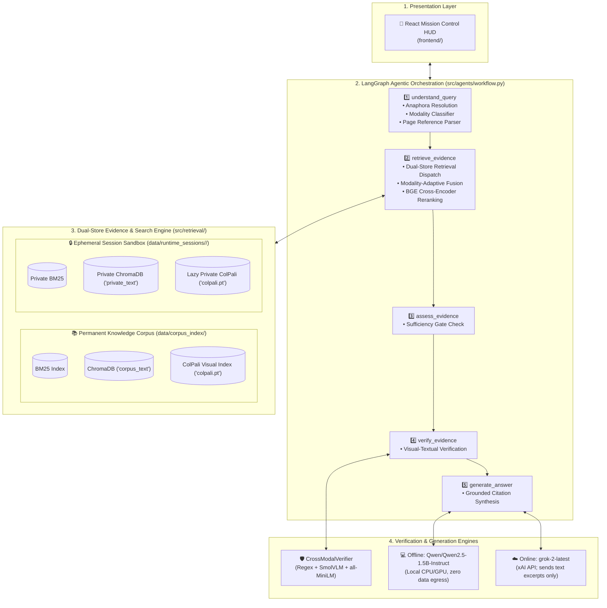

# Space RAG 🛰️

### *Agentic Multimodal Retrieval-Augmented Generation for Aerospace Engineering & Satellite Missions*

[](https://www.python.org/)
[](https://github.com/langchain-ai/langgraph)
[](https://huggingface.co/vidore/colpali-v1.3)
[](https://www.trychroma.com/)
[](LICENSE)
[](data/benchmark_evaluation_results.json)

---

## 📌 Executive Overview

**Space RAG** is an agentic, multimodal Retrieval-Augmented Generation platform engineered specifically for **aerospace engineering, satellite mission operations, and Earth observation remote sensing documentation**. 

Technical aerospace documents present unique multimodal challenges: dense telemetry tables (apogee/perigee, delta-V, burn durations), orbital trajectory graphs, payload sensor schematics, and confidential flight specifications. Generic text-only RAG pipelines fail when faced with these documents—text chunking breaks tables, OCR ignores graphical nuances, and embeddings blur numerical precision.

Space RAG solves this with a **dual-store, source-aware architecture** orchestrated by a **LangGraph state machine**:

* 🖼️ **Multi-Vector Visual Retrieval via ColPali**: Evaluates 150 DPI page renders directly without lossy OCR.
* 🔒 **Dual-Store Isolation & Privacy**: Concurrently queries permanent NASA/GSFC reference standards and temporary private user flight specifications without data leakage.
* ⚖️ **Adaptive Mathematical Score Fusion**: Blends BM25 lexical, Chroma dense vector, and ColPali visual scores based on automated query modality detection.
* 🛡️ **Cross-Modal Verification**: Verifies numerical claims against visual pages using `SmolVLM-500M` and semantic similarity checks before answering.
* 💻 **Dual Generation Engines**: Choose between an **Offline Air-Gapped Engine** (`Qwen2.5-1.5B-Instruct` for secure/classified deployments) and an **Online Engine** (`grok-2-latest` via xAI API).
* 🖥️ **Mission Control Client Interface**: High-tech **React + Vite Mission Control HUD** with real-time SSE token streaming, telemetry monitoring, and interactive document inspection.

---

## 🏗️ System Architecture



---

## 🌟 Key Features

### 1. Dual-Store Isolation & Strict Provenance
Space RAG manages two evidence repositories with distinct privacy and citation behaviors:
* **Permanent Knowledge Corpus** (`data/corpus_index/`): Houses baseline aerospace engineering standards (e.g., TROPICS constellation mission architecture, NASA GSFC guidelines). Provenance is masked; facts are synthesized naturally as foundational AI background knowledge without exposing filenames, paths, or internal IDs.
* **Private Session Sandbox** (`data/runtime_sessions/<session_id>/`): Created when a user uploads a specification PDF. Completely isolated per UUID session, text-indexed immediately, and ColPali visual-indexed lazily. Strict citations are generated for the user: `[document.pdf, p. 14]`. Upon session termination or after 12 hours, all files and SQLite database handles are cleanly purged.

### 2. Tri-Modal Retrieval & Dynamic Score Fusion
Queries are classified into `text`, `visual`, or `multimodal` intents with explicit page targeting (`page \d+`):
* **Adaptive Scoring Weights**:
  * **Text Queries**: $0.80 \times \text{Text} + 0.20 \times \text{Visual}$
  * **Visual Queries**: $0.25 \times \text{Text} + 0.75 \times \text{Visual}$
  * **Multimodal Queries**: $0.40 \times \text{Text} + 0.60 \times \text{Visual}$
* **Target Bonuses**: $+0.40$ for explicit target page matches; $+0.03$ to $+0.25$ for private document focus.
* **Cross-Encoder Reranking**: Top candidates are scored using `BAAI/bge-reranker-base` with pair caching (`_RERANK_PAIR_CACHE`).

### 3. Visual Document Understanding via ColPali
Instead of discarding document formatting through standard OCR, [ColPali](https://huggingface.co/vidore/colpali-v1.3) renders pages at 150 DPI and encodes them into multi-vector patches. Late-interaction similarity search allows the user to query trajectory curves, sensor layouts, and satellite subsystem tables directly.

### 4. Cross-Modal Claim Verification
Multimodal evidence items are routed through `CrossModalVerifier`:
1. Extracts numerical assertions (apogee, perigee, delta-V, inclination).
2. Runs `HuggingFaceTB/SmolVLM-500M-Instruct` on the rendered page image.
3. Computes semantic alignment with `all-MiniLM-L6-v2` to assign structured verification tags (`VERIFIED`, `CONTRADICTED`, `UNVERIFIED`).

---

## 📊 Empirical Evaluation Benchmark

Benchmarked on 15 mission-critical aerospace queries across tabular telemetry, mission specifications, and visual diagrams ([data/benchmark_evaluation_results.json](data/benchmark_evaluation_results.json)):

| Metric | Dense-Only Baseline | BM25-Only Baseline | SpaceBot (Proposed Architecture) |
| :--- | :---: | :---: | :---: |
| **Overall Hit Rate@3** | 60.0% | 73.3% | **93.3%** |
| **Mean Reciprocal Rank (MRR@3)** | 0.444 | 0.656 | **0.900** |
| **Visual Category Hit Rate** | 0.0% | 40.0% | **80.0%** |
| **Prose Category Hit Rate** | 80.0% | 80.0% | **100.0%** |
| **Tabular Category Hit Rate** | 100.0% | 100.0% | **100.0%** |
| **Average Query Latency** | 1.20s | 0.01s | 13.39s (Includes ColPali & VLM on CPU) |

> **Key Insight**: Pure dense retrieval failed on visual figures (0% Hit Rate). Integrating ColPali increased visual accuracy to **80.0%**, while multi-channel score fusion achieved a **93.3% overall hit rate** and **0.900 MRR**.

---

## 📁 Repository Structure

```text
Space RAG/
├── app/
│   └── server.py                      # FastAPI Mission Control API & Static Frontend Server
├── configs/
│   └── config.yaml                    # System configuration & model designations
├── data/
│   ├── corpus/                        # Permanent reference PDFs (TROPICS, GSFC, etc.)
│   ├── corpus_index/                  # Permanent indexes (BM25, ChromaDB, ColPali, Manifest)
│   ├── runtime_sessions/              # Temporary UUID private user sandboxes
│   └── benchmark_evaluation_results.json # Quantitative benchmark evaluation data
├── docs/                              # Architecture specs & reference papers
│   ├── papers/                        # Reference research papers (BM25, ColPali, DPR)
│   ├── TECHNICAL_ARCHITECTURE.md      # In-depth technical architecture specification
│   └── SOURCE_AWARE_ARCHITECTURE.md   # Dual-store source-aware documentation
├── frontend/                          # React + Vite Mission Control HUD
│   ├── src/
│   │   ├── App.jsx                    # Telemetry interface with visual page lightbox
│   │   └── index.css                  # Modern dark glassmorphic styling
│   └── package.json                   # UI dependencies
├── scripts/
│   ├── build_corpus.ps1               # PowerShell helper to build permanent corpus
│   ├── evaluate_benchmark.py          # Benchmark runner (Hit Rate, MRR, Latency)
│   ├── start_react_ui.ps1             # Launch FastAPI backend + Vite React dev server
│   └── start_server.ps1               # Launch unified FastAPI production server
├── src/
│   ├── agents/
│   │   ├── state.py                   # SpaceRAGState TypedDict
│   │   └── workflow.py                # LangGraph 5-node state machine & streaming
│   ├── generation/
│   │   └── answer_generator.py        # Dual LLM engine (Qwen / Grok-2) & provenance policy
│   ├── indexing/
│   │   ├── bm25_index.py              # BM25Okapi lexical index builder
│   │   ├── chroma_indexer.py          # ChromaDB cosine index with Windows lock release
│   │   ├── corpus_builder.py          # Permanent corpus indexing orchestrator
│   │   ├── index_document.py          # Fast private session indexing
│   │   ├── reranker.py                # BGE cross-encoder re-ranking
│   │   └── visual_indexer.py          # ColPali multi-vector page indexer & caching
│   ├── ingestion/
│   │   ├── manifest_builder.py        # Document catalog builder
│   │   ├── page_renderer.py           # PyMuPDF 150 DPI page renderer
│   │   ├── pipeline.py                # PDF extraction & ingestion pipeline
│   │   └── session_manager.py         # Session lifecycle & Windows handle teardown
│   ├── retrieval/
│   │   ├── multimodal_retriever.py    # SourceAwareMultimodalRetriever
│   │   ├── query_modality.py          # Tri-modal classifier (text, visual, multimodal)
│   │   ├── score_fusion.py            # Min-Max score fusion & page bonuses
│   │   ├── source_text_retriever.py   # Hybrid BM25 + Chroma single-source search
│   │   └── source_visual_retriever.py # Lazy ColPali single-source page search
│   └── verification/
│       ├── cross_modal_verifier.py    # Numerical claim & visual alignment verifier
│       └── visual_verifier.py         # SmolVLM-500M inference wrapper
├── tests/                             # Comprehensive test suites (Tasks 1-20 & E2E)
├── PROJECT_KNOWLEDGE.md               # Detailed architectural knowledge base
└── requirements.txt                   # Core Python dependencies
```

---

## 🚀 Quickstart & Setup

### 1. Environment Setup
Clone the repository and activate the environment:
```powershell
# Windows PowerShell
.\renv\Scripts\Activate.ps1

# Verify installed packages
python test_environment.py
```

### 2. Build the Permanent Knowledge Corpus
Place your baseline reference PDFs (e.g. mission specs, flight handbooks) in `data/corpus/` and run:
```powershell
python -m src.indexing.corpus_builder
# Or run the script:
.\scripts\build_corpus.ps1
```
*This extracts text, renders 150 DPI page PNGs, builds BM25 and Chroma vector stores, and creates `data/corpus_index/colpali.pt`.*

### 3. Launching the Application

#### Option A: Unified FastAPI Production Server + Built React HUD
```powershell
.\scripts\start_server.ps1
# Server runs at: http://127.0.0.1:8000
```

#### Option B: React Mission Control HUD (Development Mode)
```powershell
.\scripts\start_react_ui.ps1
# Starts FastAPI on port 8000 and Vite dev server on port 5173
```

---

## ⚙️ Configuration & Model Settings

Configuration settings are managed in [`configs/config.yaml`](configs/config.yaml) and environment variables:

| Setting / Variable | Default | Description |
| :--- | :--- | :--- |
| `models.embedding` | `BAAI/bge-base-en-v1.5` | Dense vector embedding model |
| `models.reranker` | `BAAI/bge-reranker-base` | Cross-encoder reranking model |
| `models.reasoning` | `Qwen/Qwen2.5-1.5B-Instruct` | Local offline reasoning model |
| `visual.model` | `vidore/colpali-v1.3` | Vision-language document retriever |
| `visual.verifier` | `HuggingFaceTB/SmolVLM-500M-Instruct` | Visual verification model |
| `XAI_API_KEY` | *(Optional)* | API Key for Online Grok-2 inference |
| `XAI_MODEL` | `grok-2-latest` | Model name for xAI online endpoint |

---

## 🧪 Running Tests & Benchmarks

The project includes phased unit tests and end-to-end integration verification:

```powershell
# Phased Verification Suites (Tasks 1 to 20)
python tests/test_tasks_1_to_5.py     # Session sandbox, ingestion, corpus indexing
python tests/test_tasks_6_to_10.py    # ColPali visual retrieval, modality routing, fusion
python tests/test_tasks_11_to_15.py   # LangGraph workflow, Qwen/Grok generation, citations
python tests/test_tasks_16_to_20.py   # Windows handle teardown, cleanup, session isolation

# Deep End-to-End Integration Pipeline Test
python tests/test_end_to_end_rag.py

# Run Quantitative Empirical Evaluation Benchmark
python scripts/evaluate_benchmark.py
```

---

## 📖 Deep Architectural Knowledge

For an exhaustive, in-depth breakdown of mathematical scoring models, Windows SQLite handle mitigation, anaphora resolution heuristics, and engineering design decisions, refer to:
* [PROJECT_KNOWLEDGE.md](PROJECT_KNOWLEDGE.md)
* [TECHNICAL_ARCHITECTURE.md](docs/TECHNICAL_ARCHITECTURE.md)
* [SOURCE_AWARE_ARCHITECTURE.md](docs/SOURCE_AWARE_ARCHITECTURE.md)
* [Foundational Papers](docs/papers/) (BM25, ColPali, Dense Passage Retrieval)