# Space RAG — Technical Architecture Specification

## 1. Executive Technical Overview

**Space RAG** is an agentic, multimodal Retrieval-Augmented Generation (RAG) platform tailored for aerospace engineering, satellite mission operations, and Earth observation remote sensing documentation. It addresses the unique challenges of complex technical documents—such as dense telemetry tables, orbital trajectory graphs, payload sensor schemas, and cross-source data privacy—through a source-aware, dual-store architecture orchestrated by a LangGraph state machine.

---

## 2. Top-to-Bottom Technical Architecture Diagram

```mermaid
flowchart TD
    %% ========================================================
    %% LAYER 1: CLIENT & PRESENTATION LAYER
    %% ========================================================
    subgraph L1 ["LAYER 1: Client & Presentation Interface"]
        direction TB
        User(["🧑‍🚀 Aerospace Engineer / User"])
        
        subgraph Mission_Control_HUD ["🚀 Mission Control HUD (frontend/ & app/server.py)"]
            ChatUI["💬 Interactive Mission Control HUD<br/>• Real-time SSE token streaming<br/>• Session chat history persistence<br/>• Suggested aerospace telemetry pills"]
            DocUpload["📎 Private Document Sandbox<br/>• Drag-and-drop PDF uploader<br/>• Live active document badge<br/>• Ephemeral session detach & teardown"]
            SysControls["⚙️ Engine & Knowledge Controls<br/>• Offline (Qwen) vs Online (Grok) toggle<br/>• Memory-only xAI API Key input<br/>• One-click knowledge index re-sync"]
            VisualExpander["🖼️ Referenced Visual Pages Expander<br/>• Interactive lightbox inspector for 150 DPI pages"]
        end

        User <-->|"Natural Language Prompt"| ChatUI
        User -->|"Uploads Private Flight Spec PDF"| DocUpload
        User -->|"Selects Inference Engine"| SysControls
        ChatUI -.->|"Displays Document Pages"| VisualExpander
    end

    %% ========================================================
    %% LAYER 2: AGENTIC GRAPH ORCHESTRATION
    %% ========================================================
    subgraph L2 ["LAYER 2: Agentic State Graph Orchestration (src/agents/)"]
        direction TB
        StateDef["📦 SpaceRAGState TypedDict (src/agents/state.py)<br/>• query, standalone_query, chat_history<br/>• modality (text | visual | multimodal), page_reference<br/>• retrieval_results, sufficiency, verification_summary<br/>• answer, citations, source_mix"]

        subgraph Graph_Nodes ["LangGraph State Machine (src/agents/workflow.py)"]
            N_Understand["1️⃣ understand_query<br/>• Anaphora resolution (pronouns: it, they, this)<br/>• QueryModalityDetector (text / visual / multimodal)<br/>• Page reference parser (e.g., 'page 14')"]
            N_Retrieve["2️⃣ retrieve_evidence<br/>• Dual-store retrieval dispatch<br/>• Modality-adaptive score fusion<br/>• Cross-encoder reranking"]
            N_Assess["3️⃣ assess_evidence<br/>• Gating: sufficiency = sufficient | insufficient"]
            N_Verify["4️⃣ verify_evidence<br/>• Aggregate cross-modal verification checks<br/>• Status: VERIFIED | CONTRADICTED | UNVERIFIED"]
            N_Generate["5️⃣ generate_answer<br/>• Grounded synthesis prompt assembly<br/>• Strict provenance citation enforcement"]
        end

        ChatUI -->|"Invoke Graph"| N_Understand
        N_Understand --> N_Retrieve
        N_Retrieve --> N_Assess
        N_Assess -->|"Sufficient"| N_Verify
        N_Verify --> N_Generate
    end

    %% ========================================================
    %% LAYER 3: MULTIMODAL RETRIEVAL & FUSION ENGINE
    %% ========================================================
    subgraph L3 ["LAYER 3: Multimodal Retrieval & Fusion Engine (src/retrieval/)"]
        direction TB
        Retriever["🔍 SourceAwareMultimodalRetriever (multimodal_retriever.py)"]

        subgraph Modality_Detection ["Modality Classifier (query_modality.py)"]
            ModText["Text Query (0.80 Text + 0.20 Visual)"]
            ModVis["Visual Query (0.25 Text + 0.75 Visual)"]
            ModMulti["Multimodal Query (0.40 Text + 0.60 Visual)"]
        end

        subgraph Score_Fusion ["Score Fusion & Bonuses (score_fusion.py)"]
            MinMaxNorm["Min-Max Score Normalization"]
            PageBonus["+0.40 Explicit Target Page Bonus"]
            PrivBonus["+0.03 Tie-break / +0.25 Target Document Bonus"]
            CrossRerank["Cross-Encoder Reranker<br/>(BAAI/bge-reranker-base)"]
        end

        N_Retrieve <-->|"Query Request"| Retriever
        Retriever --> Modality_Detection
        Modality_Detection --> MinMaxNorm
        MinMaxNorm --> PageBonus --> PrivBonus --> CrossRerank
        CrossRerank -->|"Ranked Top-k Results"| N_Retrieve
    end

    %% ========================================================
    %% LAYER 4: DUAL-STORE EVIDENCE REPOSITORIES
    %% ========================================================
    subgraph L4 ["LAYER 4: Dual Evidence Stores & Indexing Pipelines"]
        direction TB
        
        subgraph Store_Corpus ["📚 Permanent Knowledge Corpus (data/corpus_index/)"]
            C_PDF["📄 Permanent Aerospace PDFs<br/>(data/corpus/*.pdf)"]
            C_Build["⚙️ corpus_builder.py"]
            C_BM25[("📑 BM25 Lexical Index<br/>bm25.pkl")]
            C_Chroma[("⚡ ChromaDB Collection<br/>'corpus_text' (Cosine)")]
            C_ColPali[("🖼️ ColPali Visual Index<br/>colpali.pt (Multi-vector)")]
            C_Manifest[("📋 corpus_manifest.json")]

            C_PDF --> C_Build
            C_Build --> C_BM25
            C_Build --> C_Chroma
            C_Build --> C_ColPali
            C_Build --> C_Manifest
        end

        subgraph Store_Private ["🔒 Ephemeral Session Sandbox (data/runtime_sessions/<session_id>/)"]
            P_Mgr["🛡️ session_manager.py<br/>• UUID sandbox creation<br/>• Chroma handle close()<br/>• Stale sweeper (>12h)"]
            P_Pipe["⚙️ pipeline.py<br/>• Text extractor (fitz)<br/>• 150 DPI page renderer"]
            P_BM25[("📑 Private BM25 Index<br/>indexes/bm25.pkl")]
            P_Chroma[("⚡ Private ChromaDB<br/>chroma/ 'private_text'")]
            P_ColPali[("🖼️ Lazy ColPali Index<br/>indexes/colpali.pt<br/>(Indexed on first visual query)")]

            DocUpload -->|"Stream PDF Bytes"| P_Mgr
            P_Mgr --> P_Pipe
            P_Pipe --> P_BM25
            P_Pipe --> P_Chroma
            P_Pipe -.->|"Lazy Indexing"| P_ColPali
        end

        Retriever <-->|"Search Corpus"| Store_Corpus
        Retriever <-->|"Search Private"| Store_Private
    end

    %% ========================================================
    %% LAYER 5: CROSS-MODAL VERIFICATION
    %% ========================================================
    subgraph L5 ["LAYER 5: Visual-Textual Verification (src/verification/)"]
        direction TB
        CMV["🛡️ CrossModalVerifier (cross_modal_verifier.py)"]
        
        subgraph Verification_Components ["Verification Pipeline"]
            NumExtract["🔢 Regex Numerical Value Extractor<br/>(apogee, perigee, delta-V, inclination, dates)"]
            VLM_Inference["👁️ SmolVLM-500M-Instruct (visual_verifier.py)<br/>(Inspects 150 DPI page image vs text claims)"]
            SemanticAlign["⚖️ Semantic Alignment Check (all-MiniLM-L6-v2)<br/>Cosine similarity between text claim and VLM reading"]
            StatusAssign["🏷️ Status Assignment<br/>• VERIFIED (Confidence > 0.75)<br/>• CONTRADICTED<br/>• UNVERIFIED / UNAVAILABLE"]
        end

        N_Verify <-->|"Verify Top Candidates"| CMV
        CMV --> NumExtract
        CMV --> VLM_Inference
        NumExtract & VLM_Inference --> SemanticAlign --> StatusAssign
        StatusAssign -->|"Verification Metadata"| N_Verify
    end

    %% ========================================================
    %% LAYER 6: GROUNDED GENERATION & PROVENANCE CONTROL
    %% ========================================================
    subgraph L6 ["LAYER 6: Dual LLM Generation & Provenance Engine (src/generation/)"]
        direction TB
        AnsGen["✍️ AnswerGenerator (answer_generator.py)"]

        subgraph Provenance_Policy ["Strict Provenance & Privacy Rules"]
            CorpusPolicy["🔒 Permanent Corpus Evidence:<br/>• Synthesized as natural AI background knowledge<br/>• NEVER mention 'corpus', file paths, or internal IDs"]
            PrivatePolicy["📎 Private Session Evidence:<br/>• Strictly cited in natural language:<br/>[document.pdf, p. X]"]
        end

        subgraph Generation_Engines ["Dual Inference Engines"]
            LocalEngine["💻 Offline Engine: Qwen/Qwen2.5-1.5B-Instruct<br/>• Local CPU bfloat16 inference<br/>• Zero telemetry or data egress<br/>• Stream token generator"]
            OnlineEngine["☁️ Online Engine: xAI Grok-2 API<br/>• OpenAI client over https://api.x.ai/v1<br/>• Strictly sends top-5 retrieved excerpts<br/>• Raw PDF files are NEVER transmitted"]
        end

        N_Generate <--> AnsGen
        AnsGen --> Provenance_Policy
        Provenance_Policy --> Generation_Engines
    end

    %% Response Delivery
    Generation_Engines -->|"Stream Tokens"| ChatUI
    PrivatePolicy -->|"Citation Badges"| ChatUI
    Store_Private -.->|"Page Images"| VisualExpander
```



---

## 3. Component Architecture Breakdown

### 3.1 Layer 1: Presentation & Session Sandbox
* **Implementation**: [`frontend/`](file:///c:/Users/Pushkar%20Shelar/Desktop/Space%20RAG/frontend) and [`app/server.py`](file:///c:/Users/Pushkar%20Shelar/Desktop/Space%20RAG/app/server.py)
* **Responsibilities**:
  * Renders a responsive, modern dark-themed aerospace Mission Control HUD with glassmorphism and Lucide icons.
  * Manages real-time token streaming via Server-Sent Events (SSE).
  * Handles private PDF uploads with immediate file isolation and active session badge displays.
  * Provides manual and automatic sandbox teardown, detaching session indices safely from disk.
  * Displays referenced document pages in an interactive lightbox modal inspector.

---

### 3.2 Layer 2: Agentic State Graph Orchestration
* **Implementation**: [`src/agents/workflow.py`](file:///c:/Users/Pushkar%20Shelar/Desktop/Space%20RAG/src/agents/workflow.py), [`src/agents/state.py`](file:///c:/Users/Pushkar%20Shelar/Desktop/Space%20RAG/src/agents/state.py)
* **State Object (`SpaceRAGState`)**:
  ```python
  class SpaceRAGState(TypedDict, total=False):
      session_id: str | None
      session_root: str | None
      document_name: str | None
      corpus_root: str
      query: str
      standalone_query: str
      chat_history: List[Dict[str, str]]
      api_key: str | None
      top_k: int
      retrieval_k: int
      query_modality: str
      page_reference: int | None
      retrieval_results: List[Dict[str, Any]]
      sufficiency: str
      verification_summary: List[Dict[str, Any]]
      model_mode: str
      model: str
      answer: str
      citations: List[str]
      source_mix: Dict[str, int]
      error: str | None
  ```
* **Execution Flow**:
  1. **`understand_query`**: Resolves conversational anaphora (*"what was its apogee?"* $\rightarrow$ *"EBN #2 what was its apogee?"*) using regex entity matching over recent history; identifies explicit page anchors (`page \d+`).
  2. **`retrieve_evidence`**: Calls `SourceAwareMultimodalRetriever` across active stores.
  3. **`assess_evidence`**: Validates whether candidate count > 0.
  4. **`verify_evidence`**: Collects `CrossModalVerifier` outputs for all multimodal items.
  5. **`generate_answer`**: Invokes `AnswerGenerator` to synthesize grounded output with source-aware citations.

---

### 3.3 Layer 3: Multimodal Retrieval & Fusion Engine
* **Implementation**: [`src/retrieval/multimodal_retriever.py`](file:///c:/Users/Pushkar%20Shelar/Desktop/Space%20RAG/src/retrieval/multimodal_retriever.py), [`src/retrieval/score_fusion.py`](file:///c:/Users/Pushkar%20Shelar/Desktop/Space%20RAG/src/retrieval/score_fusion.py), [`src/retrieval/query_modality.py`](file:///c:/Users/Pushkar%20Shelar/Desktop/Space%20RAG/src/retrieval/query_modality.py)
* **Mathematical Scoring Model**:
  For each retrieved item $i$, scores are normalized via min-max scaling:
  $$S_{\text{norm}}(s) = \frac{s - \min(S)}{\max(S) - \min(S)}$$
  The composite fusion score is computed based on query modality:
  $$S_{\text{fusion}}(i) = w_{\text{text}} \cdot S_{\text{text, norm}}(i) + w_{\text{vis}} \cdot S_{\text{vis, norm}}(i) + \Delta_{\text{page}}(i) + \Delta_{\text{private}}(i)$$
  
  Where weights are dynamically assigned:
  * **Text Modality**: $w_{\text{text}} = 0.80, \quad w_{\text{vis}} = 0.20$
  * **Visual Modality**: $w_{\text{text}} = 0.25, \quad w_{\text{vis}} = 0.75$
  * **Multimodal Modality**: $w_{\text{text}} = 0.40, \quad w_{\text{vis}} = 0.60$
  * **Page Anchor Bonus**: $\Delta_{\text{page}} = +0.40$ if $i.\text{page\_number} == \text{target\_page}$
  * **Private Tie-Break**: $\Delta_{\text{private}} = +0.03$ (escalated to $+0.25$ if query explicitly references the attached document)

* **Cross-Encoder Reranking**:
  Top candidates pass through `BAAI/bge-reranker-base`:
  $$S_{\text{final}}(i) = 0.60 \cdot S_{\text{fusion}}(i) + 0.40 \cdot S_{\text{BGE, norm}}(i) + \Delta_{\text{private}}$$

---

### 3.4 Layer 4: Dual Evidence Stores & Indexing Pipelines
* **Implementation**: [`src/indexing/corpus_builder.py`](file:///c:/Users/Pushkar%20Shelar/Desktop/Space%20RAG/src/indexing/corpus_builder.py), [`src/ingestion/session_manager.py`](file:///c:/Users/Pushkar%20Shelar/Desktop/Space%20RAG/src/ingestion/session_manager.py), [`src/indexing/chroma_indexer.py`](file:///c:/Users/Pushkar%20Shelar/Desktop/Space%20RAG/src/indexing/chroma_indexer.py), [`src/indexing/visual_indexer.py`](file:///c:/Users/Pushkar%20Shelar/Desktop/Space%20RAG/src/indexing/visual_indexer.py)
* **Storage Matrix**:

| Feature | Permanent Knowledge Corpus | Ephemeral Private Session Sandbox |
| :--- | :--- | :--- |
| **Location** | `data/corpus_index/` | `data/runtime_sessions/<session_id>/` |
| **Lexical Index** | `bm25.pkl` (BM25Okapi over text chunks) | `indexes/bm25.pkl` (Immediate build) |
| **Dense Vector Index** | `chroma/` collection `corpus_text` | `chroma/` collection `private_text` |
| **Visual Index** | `colpali.pt` (Multi-vector PyTorch tensors) | `indexes/colpali.pt` (**Lazy**: Built on first visual query) |
| **Images & Pages** | Rendered 150 DPI PNGs in `documents/*/pages` | Rendered 150 DPI PNGs in `pages/` |
| **Lifecycle** | Permanent, rebuilt via admin trigger | Auto-deleted on session end or background garbage sweeper (>12h) |
| **Windows Locking** | Read-only access | Dedicated `close()` stops Chroma SQLite system before `shutil.rmtree` |

---

### 3.5 Layer 5: Cross-Modal Verification
* **Implementation**: [`src/verification/cross_modal_verifier.py`](file:///c:/Users/Pushkar%20Shelar/Desktop/Space%20RAG/src/verification/cross_modal_verifier.py), [`src/verification/visual_verifier.py`](file:///c:/Users/Pushkar%20Shelar/Desktop/Space%20RAG/src/verification/visual_verifier.py)
* **Verification Workflow**:
  1. Detects whether candidate is multimodal or visual.
  2. Extracts numbers from retrieved text claims (e.g. `379454 km`, `343.19 m/s`).
  3. Formats prompt with rendered 150 DPI page image and executes `HuggingFaceTB/SmolVLM-500M-Instruct`.
  4. Computes semantic alignment between VLM output and claim using `all-MiniLM-L6-v2`.
  5. Produces structured output:
     ```json
     {
       "status": "VERIFIED",
       "confidence": 0.88,
       "claim_type": "numerical",
       "vlm_observation": "Table 4 lists EBN #5 apogee as 379454 km."
     }
     ```

---

### 3.6 Layer 6: Grounded Generation & Provenance Enforcement
* **Implementation**: [`src/generation/answer_generator.py`](file:///c:/Users/Pushkar%20Shelar/Desktop/Space%20RAG/src/generation/answer_generator.py)
* **Dual Inference Engines**:
  * **Offline Engine**: `Qwen/Qwen2.5-1.5B-Instruct`
    * Loaded in CPU `bfloat16`/`float32` via HuggingFace `AutoModelForCausalLM`.
    * Zero network egress for air-gapped or sensitive aerospace deployments.
  * **Online Engine**: `grok-2-latest` (xAI API)
    * Connects via OpenAI SDK at `https://api.x.ai/v1`.
    * **Data Privacy Guarantee**: Only retrieved text chunks and verification summaries are sent. The original PDF document is never transmitted.
* **Strict Source-Aware Prompting Rules**:
  * **Permanent Corpus Rules**: The model synthesizes facts as foundational aerospace domain knowledge. It is strictly forbidden from using phrases like *"according to the corpus"* or citing corpus file paths.
  * **Private Document Rules**: All private evidence must include natural language document and page citations (e.g., `[Flight_Readiness_Review.pdf, p. 14]`).

---

## 4. Empirical Evaluation Benchmark

Empirical evaluation from [`data/benchmark_evaluation_results.json`](file:///c:/Users/Pushkar%20Shelar/Desktop/Space%20RAG/data/benchmark_evaluation_results.json) demonstrates the superiority of the hybrid multimodal architecture across 15 mission-critical benchmark queries:

| Metric | Dense-Only Baseline | BM25-Only Baseline | SpaceBot (Proposed Architecture) |
| :--- | :---: | :---: | :---: |
| **Overall Hit Rate@3** | 60.0% | 73.3% | **93.3%** |
| **Mean Reciprocal Rank (MRR@3)** | 0.444 | 0.656 | **0.900** |
| **Visual Category Hit Rate** | 0.0% | 40.0% | **80.0%** |
| **Prose Category Hit Rate** | 80.0% | 80.0% | **100.0%** |
| **Tabular Category Hit Rate** | 100.0% | 100.0% | **100.0%** |
| **Average Query Latency** | 1.20s | 0.01s | 13.39s (Includes ColPali & VLM on CPU) |

---

## 5. File & Directory Reference Map

```text
Space RAG/
├── app/
│   └── server.py                      # Layer 1: FastAPI Mission Control server & static HUD server
├── frontend/                          # Layer 1: React + Vite Mission Control HUD
├── configs/
│   └── config.yaml                    # System configuration & model designations
├── data/
│   ├── corpus/                        # Permanent PDF documents (TROPICS, GSFC, etc.)
│   ├── corpus_index/                  # Permanent indexes (BM25, Chroma, ColPali, Manifest)
│   ├── runtime_sessions/              # Ephemeral private user sessions
│   └── benchmark_evaluation_results.json # Quantitative evaluation benchmark data
├── scripts/
│   ├── build_corpus.ps1               # PowerShell helper to build permanent corpus
│   └── evaluate_benchmark.py          # Benchmark runner (Hit Rate, MRR, Latency)
├── src/
│   ├── agents/
│   │   ├── state.py                   # Layer 2: SpaceRAGState TypedDict definition
│   │   └── workflow.py                # Layer 2: LangGraph workflow compilation & streaming
│   ├── generation/
│   │   └── answer_generator.py        # Layer 6: Dual LLM generation & provenance enforcement
│   ├── indexing/
│   │   ├── bm25_index.py              # Layer 4: BM25Okapi serialized index
│   │   ├── chroma_indexer.py          # Layer 4: ChromaDB cosine vector index with close()
│   │   ├── colpali_embedder.py        # Layer 4: ColPali PyTorch feature embedder
│   │   ├── corpus_builder.py          # Layer 4: Permanent corpus builder orchestrator
│   │   ├── index_document.py          # Layer 4: Private session indexing
│   │   ├── reranker.py                # Layer 3: BGE cross-encoder re-ranking
│   │   ├── text_chunker.py            # Layer 4: Overlapping character chunker
│   │   └── visual_indexer.py          # Layer 4: ColPali multi-vector page index
│   ├── ingestion/
│   │   ├── manifest_builder.py        # Layer 4: Per-document metadata catalog
│   │   ├── page_renderer.py           # Layer 4: PyMuPDF 150 DPI page renderer
│   │   ├── pdf_loader.py              # Layer 4: PDF loading & image extraction
│   │   ├── pipeline.py                # Layer 4: Session processing pipeline
│   │   ├── session_manager.py         # Layer 1/4: Session lifecycle & Windows handle teardown
│   │   └── text_extractor.py          # Layer 4: Page-level text extraction
│   ├── retrieval/
│   │   ├── multimodal_retriever.py    # Layer 3: SourceAwareMultimodalRetriever
│   │   ├── query_modality.py          # Layer 3: Tri-modal intent detector
│   │   ├── score_fusion.py            # Layer 3: Min-max adaptive score fusion
│   │   ├── source_text_retriever.py   # Layer 3: Single-source BM25 + Chroma hybrid search
│   │   └── source_visual_retriever.py # Layer 3: Single-source ColPali page search
│   └── verification/
│       ├── cross_modal_verifier.py    # Layer 5: CrossModalVerifier (claims vs page images)
│       └── visual_verifier.py         # Layer 5: SmolVLM-500M inference wrapper
└── tests/
    ├── test_end_to_end_rag.py         # Integration test suite
    ├── test_tasks_1_to_5.py           # Unit tests: Tasks 1-5 (Session, Ingestion, Corpus)
    ├── test_tasks_6_to_10.py          # Unit tests: Tasks 6-10 (Visual, Fusion, Rerank, Graph)
    ├── test_tasks_11_to_15.py         # Unit tests: Tasks 11-15 (Workflow, Qwen, Grok, Citations)
    └── test_tasks_16_to_20.py         # Unit tests: Tasks 16-20 (Cleanup, Teardown, Isolation)
```
